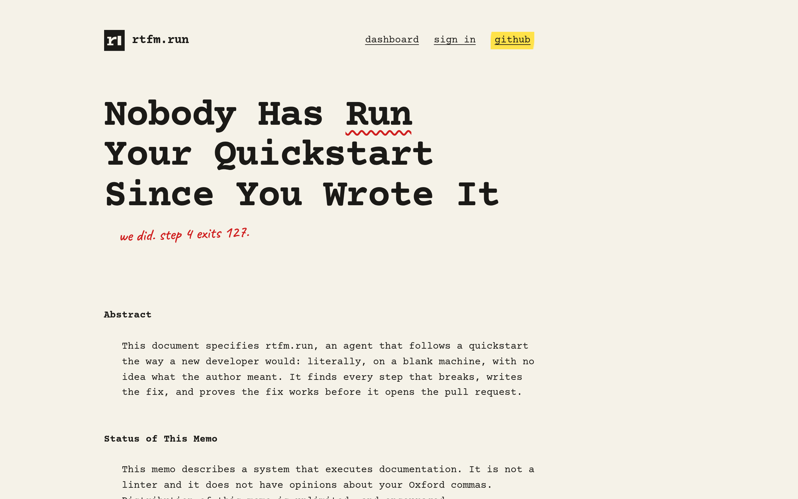
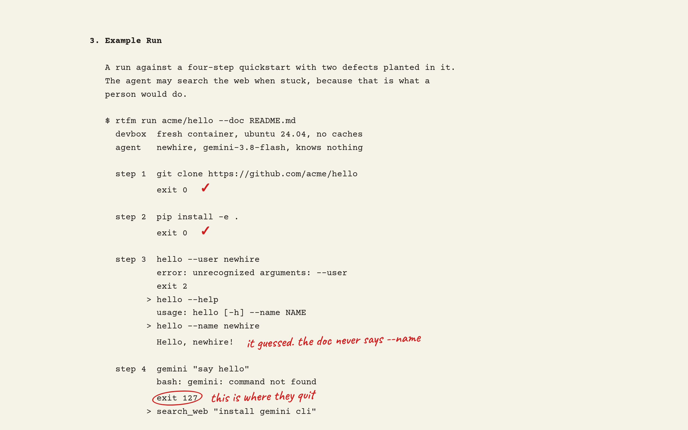
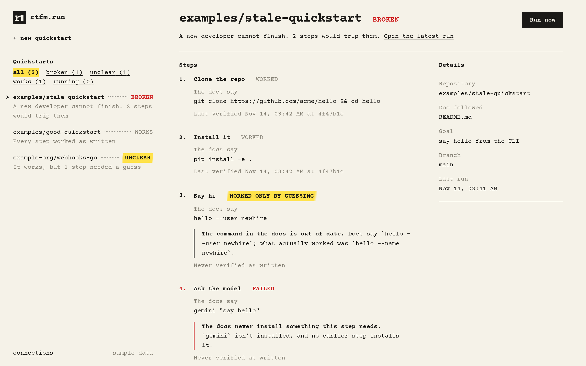
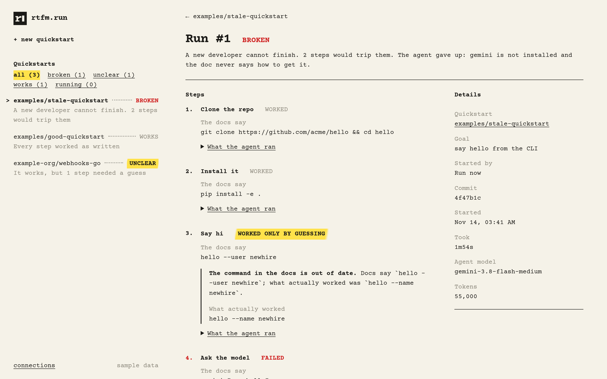

<p align="center">
  
</p>

<h1 align="center">rtfm.run</h1>

<p align="center">
  You told them to RTFM. We did. It's broken.
</p>

<p align="center">
  
</p>

rtfm.run is an agent that follows your quickstart the way a new developer would: literally, on a blank machine, with no idea what you meant. It finds every step that breaks, writes the fix, reruns the doc to prove the fix works, and opens a pull request.

This repo is the web app: the landing page and the dashboard. The agent, sandbox and API live in the [backend repo](https://github.com/vanguard-run/vanguard-run).

## What's in here

**The landing page.** Written as a plain-text RFC that somebody has gone over with a red pen, because marking up broken docs is the whole product. The example run types itself out and gets annotated as each step is judged.

<p align="center">
  
</p>

**The dashboard.** Sign in with GitHub, pick a repo and a doc, say what a new developer should end up with, and hit run. Every quickstart gets a status:

| Status | Meaning |
| --- | --- |
| Works | Every step worked exactly as written. |
| Unclear | It worked, but only because the agent guessed something the doc never said. |
| Broken | A step failed. A new developer cannot finish. |

<p align="center">
  
</p>

**The run report.** Each step shows what the doc said, what actually worked, and why it broke. Runs update live while the agent is working. If a fix was written, the patch and the evidence for it are on the same page.

<p align="center">
  
</p>

## Run it

```bash
npm install
npm run dev   # http://localhost:3000
```

With nothing else configured, the dashboard shows read-only sample data (`src/lib/sample-api.ts`), so you can click around without a backend.

## Connecting the API

The dashboard (`/dashboard`, `/login`) talks to the rtfm API (`rtfm serve` in the backend repo) straight from the browser, using the API's session cookie. Point it at the API with `RTFM_API_URL`. It is read at request time, so there is no rebuild, and `next dev` reloads `.env.local` on change:

```bash
echo 'RTFM_API_URL=http://localhost:8080' > .env.local
npm run dev
```

On the API side, set `RTFM_DASHBOARD_URL` to this app's `/dashboard` URL. The API uses it to:

- allow this origin to make credentialed CORS requests (`/api/*`, including the run event stream)
- send people here after sign-in, and back to `/login?error=…` when sign-in fails
- redirect its own `/` to the dashboard

The session cookie is `SameSite=Lax`, so the dashboard and the API must be on the same site: two ports on `localhost` in development, or `rtfm.run` and `api.rtfm.run` in production.

Local development, end to end:

```bash
# in the backend repo
rtfm github-app create           # once: registers the GitHub App, writes ~/.config/rtfm/service.env
rtfm serve --env-file ~/.config/rtfm/service.env   # API + a worker on :8080
# then open http://localhost:3000/login
```

## Where things are

| Path | What it is |
| --- | --- |
| `src/app/page.tsx` | Landing page |
| `src/app/run-replay.tsx` | The example run that types itself out |
| `src/app/login/` | Sign-in page |
| `src/app/dashboard/` | Dashboard: sidebar, quickstart page, run report, new quickstart, connections |
| `src/lib/api.ts` | Client for the backend API |
| `src/lib/api-types.ts` | The API's JSON shapes |
| `src/lib/sample-api.ts` | Sample data used when no API is configured |

Built with Next.js (App Router) and TypeScript. The agent itself runs on Gemini through the Antigravity CLI; that part is in the backend repo.
